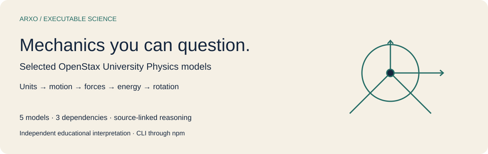
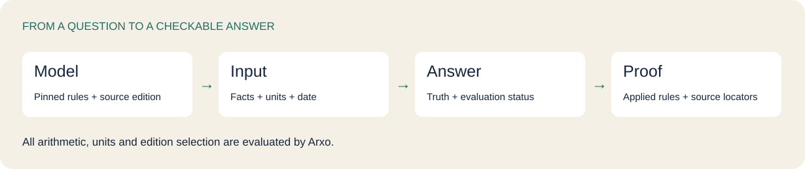
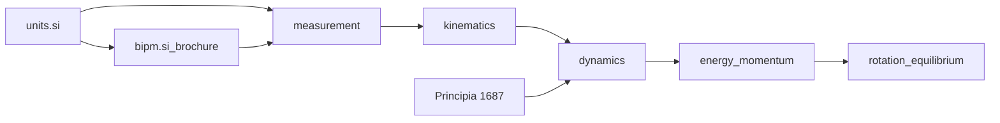
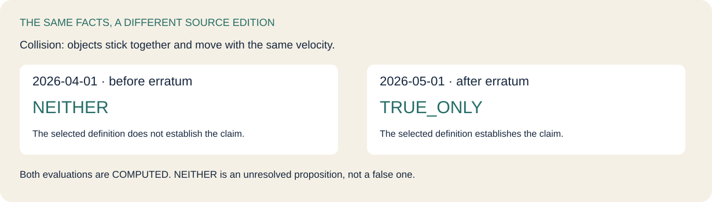
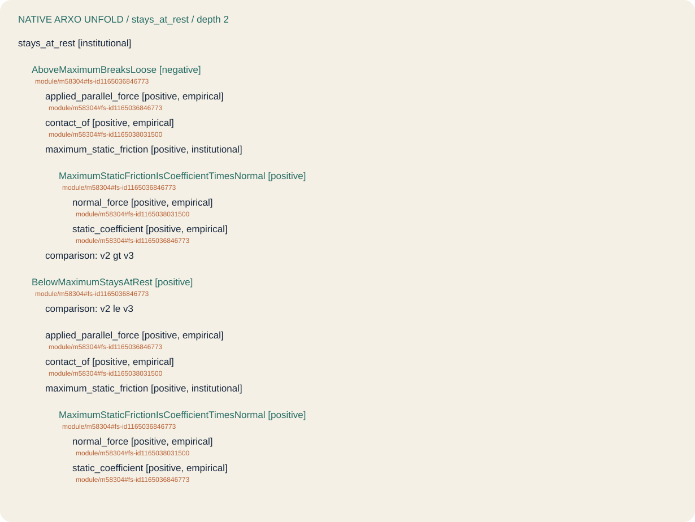

# OpenStax mechanics on Arxo

Ask selected mechanics models a question, inspect the answer and follow the rules back to their pinned textbook sources. This independent educational repository contains five **University Physics Volume 1** models, their dependency closure and twelve runnable examples.

[Run a question](#run-a-question) · [Choose a model](#choose-a-model) · [Explore examples](#explore-examples) · [Depth and boundaries](#depth-and-boundaries) · [Licenses](#licenses)

## Run a question

Install the published **Arxo CLI through npm** (Node.js 20 or newer), then clone the models:

```sh
npm install -g @arxo/cli@0.2.4
git clone https://github.com/arxohq/arxo-openstax-mechanics.git
cd arxo-openstax-mechanics
law eval examples/friction-at-limit
```

This asks whether a system stays at rest when the applied force is **80 N**, the normal force is **200 N** and the static coefficient is **0.4**. The native result is `TRUE_ONLY`, with evaluation status `COMPUTED`. Change to the existing above-limit example:

```sh
law eval examples/friction-above-limit
```

At **90 N**, the result is `FALSE_ONLY`. The original model performs the comparison and unit arithmetic. The repository contains no second implementation of the formula.

Models arrive through GitHub and the [v0.1.0 archive](https://github.com/arxohq/arxo-openstax-mechanics/releases/tag/v0.1.0). There is no model npm package; npm installs the runtime.



## Choose a model

All model versions are `0.1.0`; semantics are `law.core/0.2.11`. Chapters below identify selected source material, not complete chapter coverage.

| Model | Selected chapters | Explore the original model | Own rules | CNXML snapshots / fragments |
|---|---|---|---:|---:|
| `openstax.measurement@0.1.0` | 1–2: measurement, dimensions, vectors | [.law files](packages/openstax.measurement) | 36 | 13 / 27 |
| `openstax.kinematics@0.1.0` | 3–4: motion and acceleration | [.law files](packages/openstax.kinematics) | 22 | 13 / 15 |
| `openstax.dynamics@0.1.0` | 5–6: forces and friction | [.law files](packages/openstax.dynamics) | 10 | 13 / 13 |
| `openstax.energy_momentum@0.1.0` | 7–9: work, energy and momentum | [.law files](packages/openstax.energy_momentum) | 22 | 20 / 17 |
| `openstax.rotation_equilibrium@0.1.0` | 10–13: rotation, equilibrium and gravitation | [.law files](packages/openstax.rotation_equilibrium) | 21 | 27 / 17 |

The closure also includes [`units.si`](packages/units.si) (unit definitions), [`bipm.si_brochure`](packages/bipm.si_brochure) (pinned SI editions), and [`la.newton.principia`](packages/la.newton.principia) (the historical axiomatic framework used by dynamics). Their original identities are preserved.



The diagram summarizes the learning path. Exact imports, including direct SI and earlier-model imports, are in [models.json](models.json) and each `law.toml` / `law.lock`. Imports are vendored so model execution does not fetch a private corpus repository.

## Explore examples

Every example is captured from a retained `.lawtest` by the published CLI. Open `case.json` for the full assertions and temporal context, `query.json` for the question, `request.json` for the complete executable request, and `result.json` for the recorded canonical answer.

| Example | What to examine | Truth | Evaluation |
|---|---|---|---|
| [dimensions-match](examples/dimensions-match) | Equation terms have compatible dimensions | `TRUE_ONLY` | `COMPUTED` |
| [dimensions-differ](examples/dimensions-differ) | Dimensional inconsistency is refuted explicitly | `FALSE_ONLY` | `COMPUTED` |
| [velocity-confirmed](examples/velocity-confirmed) | Constant acceleration confirms 400 m/s | `TRUE_ONLY` | `COMPUTED` |
| [velocity-refuted](examples/velocity-refuted) | Claiming 380 m/s is refuted | `FALSE_ONLY` | `COMPUTED` |
| [friction-at-limit](examples/friction-at-limit) | Static friction at its maximum | `TRUE_ONLY` | `COMPUTED` |
| [friction-above-limit](examples/friction-above-limit) | Force exceeds maximum static friction | `FALSE_ONLY` | `COMPUTED` |
| [closed-system](examples/closed-system) | Closed-system momentum conservation | `TRUE_ONLY` | `COMPUTED` |
| [open-system](examples/open-system) | An open system lacks the closed-system conservation law | `TRUE_ONLY` | `COMPUTED` |
| [before-erratum](examples/before-erratum) | Collision definition before the pinned erratum | `NEITHER` | `COMPUTED` |
| [after-erratum](examples/after-erratum) | Same situation after the pinned erratum | `TRUE_ONLY` | `COMPUTED` |
| [equilibrium](examples/equilibrium) | Both force and torque conditions hold | `TRUE_ONLY` | `COMPUTED` |
| [force-balance-alone](examples/force-balance-alone) | Force balance alone cannot establish equilibrium | `FALSE_ONLY` | `COMPUTED` |

```sh
law eval examples/before-erratum
law eval examples/after-erratum
law inspect examples/friction-at-limit/result.json summary
law test packages/openstax.dynamics --file tests/03-friction-boundary.lawtest --json
```

The source-edition example retains the existing model’s treatment of OpenStax erratum 28340. Arxo’s `legalTime` context field selects a source edition here; it does not turn a scientific theory into legislation. Original source fragments and temporal rules remain available for review.



## Answers and reasoning

`TRUE_ONLY` means the model supports the proposition; `FALSE_ONLY` means it supports its explicit negation; `NEITHER` means neither is established; `BOTH` means conflicting support. These statuses describe reasoning from supplied facts and assumptions. They do not verify a real experiment. Absence of a premise is different from an explicit negative assertion.

Truth and evaluation status are separate: a `COMPUTED` result can be `NEITHER`. `proofGraph` records rule applications and `resultHash` identifies the canonical document. Facts retain their origins and unit-bearing values.

Inspect the native model structure independently of a case:

```sh
law engine unfold registry/world/openstax.dynamics.lawir.json stays_at_rest --clir registry/package --depth 2 --lang en --json
```

<details>
<summary>Open the native friction reasoning tree</summary>



The [original unfold JSON](reports/unfold-friction.json) is retained. This is a model-structure tree, not the proof of one particular experiment. Some resolved CNXML quotations are element opening tags; the locator leads to the complete element in the captured module. Published CLI 0.2.4 currently returns empty evaluation `sourceAnchors` for these examples. Rule IDs, model anchors and native unfold locators were checked separately; successful source-anchor propagation is not claimed.

</details>

Read the actual friction rules in [03-friction.law](packages/openstax.dynamics/03-friction.law), their [CNXML source](packages/openstax.dynamics/sources/dynamics/m58304.cnxml), and the [selected source scenario](packages/openstax.dynamics/tests/03-friction-boundary.lawtest).

## Depth and boundaries

Captured text, executable rules and complete formalization are different claims. Counts above include **own-package nodes only**, excluding imports. CNXML snapshots count captured files: energy/momentum has 19 distinct modules in 20 snapshots, including the earlier collision definition. The [machine-readable depth report](reports/formalization-depth.json) records package/source hashes, implementation hashes, editions, per-division classifications where admitted, and unmeasured publications.

| Package | Depth measurement | Why / measured denominator |
|---|---|---|
| `openstax.measurement@0.1.0` | `not_measured` | CNXML element division is not admitted by the existing depth classifier; denominator unavailable |
| `openstax.kinematics@0.1.0` | `not_measured` | CNXML element division is not admitted by the existing depth classifier; denominator unavailable |
| `openstax.dynamics@0.1.0` | `not_measured` | CNXML element division is not admitted by the existing depth classifier; denominator unavailable |
| `openstax.energy_momentum@0.1.0` | `not_measured` | CNXML element division is not admitted by the existing depth classifier; denominator unavailable |
| `openstax.rotation_equilibrium@0.1.0` | `not_measured` | CNXML element division is not admitted by the existing depth classifier; denominator unavailable |
| `units.si@0.1.0` | `not_measured` | No admitted source-division declaration; denominator unavailable |
| `bipm.si_brochure@0.1.0` | `not_measured` | No admitted source-division declaration; denominator unavailable |
| `la.newton.principia@0.1.0` | `measured` | 19 declared divisions: 16 EXECUTABLE, 3 SOURCE_ONLY; structural classification, not full semantic completeness |

Depth uses the existing `boundaries.depth`; no second classifier or invented coverage percentage is introduced. An executable division can still omit assumptions, consequences or alternative readings. For OpenStax, module/fragment/rule counts are an inventory, **not a completeness percentage**.

This selected slice is not the entire book, all of mechanics or a general simulation engine. Continuous trajectories, general vector geometry, fluids, waves, general uncertainty propagation and domains outside the retained rules remain boundaries. Scalar/unit calculations and declared assumptions have the meaning of their original models. The historical Principia dependency is explicitly a different source/reading. Empirical facts must be supplied. Institutional relation tags describe model-derived classifications; these models do not contain deontic norm templates.

## Reproduce the selected checks

Python 3.12 is needed only for delivery verification; reader execution uses `law` directly.

```sh
python3.12 tools/check.py
```

The release checked **42 scenarios in selected declared files**, eight own-package lowerings and linked worlds, and twelve reader examples. The checker verifies identities and byte hashes, native expectations, repeated canonical documents, inspection and unfold. This is a scoped check: `releaseVerified: false`, full corpus `not_checked`. See [verification evidence](reports/verification.json), [selected package suites](reports/targeted-package-checks.json) and [delivery notes](docs/DELIVERY.md).

The [source pin](source-pin.json) preserves the originating revision and captured byte hashes. Original own-package CLIR is in `registry/original`; fresh npm-CLI lowering in `registry/package`; linked closures in `registry/world`. Captured source bytes identify the snapshot even if the originating checkout contained uncommitted work. The corpus’s unpublished runtime pin is not claimed as verified.

## Licenses

OpenStax textbook content and its textual adaptations retain **CC BY-NC-SA 4.0** (noncommercial and ShareAlike). Independent Arxo code and original artwork use Apache-2.0. BIPM text retains CC BY 4.0; the Wikisource transcription retains attribution and ShareAlike terms. These conditions also apply when source text is embedded in model JSON or example requests. The bundle is not uniformly Apache-licensed.

Read [NOTICE](NOTICE), [LICENSE](LICENSE), the [retained collection notice](licenses/openstax-volume-1.collection.xml), and [full content license texts](licenses). Attribution: OpenStax, Rice University, Samuel J. Ling, Jeff Sanny, William Moebs and content contributors; BIPM; Isaac Newton and Latin Wikisource contributors. [Read the free textbook](https://openstax.org/books/university-physics-volume-1/pages/preface). This is an independent educational interpretation, with no publisher endorsement.
